# gogreenstreets.org: page inventory and current site map

Built 2026-11-17 for the site-wide design and information-architecture review. Read from the gsi-website working tree on `main` (the tree carries other sessions' uncommitted changes, including deleted `bike-lessons/offer|teach/[token]`, `trails/[slug]/gpx` and `api/og/group` routes; this inventory describes the tree as it stands), the live sitemap (fetched today: 505 URLs), and the Shift repo for app and email links.

Legend for the tables:

- **Map**: in `src/app/sitemap.ts` (Y, or "dyn" for a database-driven family, with today's live count).
- **Index**: `ok` = indexable; `noindex` = robots meta; `blocked` = disallowed in `robots.ts`; `cond` = noindex under a condition.
- **Lang**: `EN` only; `4?` = en/es/pt-BR/zh-Hans via `?lang=` or browser language (`resolveSiteLocale`); `5` = adds French (/nearby, /visiting); `path` = language in the URL.
- **In** = internal pages that link to it (beyond itself). **Out** = outside onramps seen in code.
- Flags: **ORPHAN** (no nav, footer or body link from another public page), **WEAK** (one obscure internal link), **DEAD END** (no onward step in the body besides nav/footer).

---

## 1. Page inventory (public routes)

183 `page.tsx` routes exist under `src/app` (plus route handlers). **110 are public route patterns** (counting print, embed and sub-view pages such as ride photos), listed below; 73 are behind sign-in, tokens, admin or preview and are excluded. Live, they expand to about 505 sitemap URLs: 90 town pages, 97 event pages, 57 host pages, 37 series pages, 34 English guides plus 87 translations, 28 trails, 13 semester schools, 11 roams, 5 venue parking pages and 52 static pages.

### A. Home and organization

| Path | For | Map | Index | Lang | In | Out | Flags |
|---|---|---|---|---|---|---|---|
| `/` | Home: hero, impact ledger, Shift block, "who are you" index, mission, closing CTA | Y | ok | 4? | Nav wordmark, footer | Everywhere | |
| `/about` | About GSI: story, team, what we run | Y | ok | EN | Nav About menu, footer, home MissionBlock | `/ourteam`, `/2025-new-ed-info` redirects | Links invite-only `/organizer-kit` |
| `/programs` | Programs index (WRD, WMU, corporate, schools) | Y | ok | 4? | Nav About menu, footer heading, about, WMU pages | `/blog`, `/post/*`, `/category/*` redirects | |
| `/programs/walk-ride-days` | Walk/Ride Day: one Friday a month | Y | ok | EN (es, pt-BR drafts in /preview) | Footer, home MissionBlock, about, programs, help | Bio links, `/walkridedays`, app `/go/wrd` | Does not link its own results pages |
| `/programs/what-moves-us` | What Moves Us community-listening program | Y | ok | EN | Footer, home, programs, all WMU sub-pages | Many old Wix redirects | |
| `/programs/what-moves-us/*` (7: frisoli, everett-schools, everett-community-fair, cambridge-shop-by-bike, mgh-ihp, boston-area-active-commuters, participant-voices) | WMU case studies | Y | ok | EN | WMU hub | Old Wix redirects | DEAD END (back to hub + contact only) |
| `/programs/corporate-challenge` | Legacy team commute competition for employers | Y | ok | EN | Footer Programs, programs | none | Overlaps `/shift/employers`; `/corporate-challenge` redirects to `/shift/employers`, not here |
| `/programs/town-challenge` | Spring Town Challenge pitch for town staff; Book a call; prints as a one-pager | no | noindex | EN | Town pages (TownSections, `?town=`) | Rideshare-fee and past-client emails | WEAK |
| `/get-involved` | Volunteer roles and forms | Y | ok | EN | Nav About menu, footer "Volunteer", home closing CTA, about, donate | `/volunteer`, `/friends-of-green-streets` redirects | |
| `/donate` | Donate (Donorbox) | Y | ok | EN | Nav button, footer, home closing CTA + audience index, about | | |
| `/contact` | Contact form; also the "Sponsor an event" target | Y | ok | EN | Nav About menu, footer (twice), home, 20+ pages | `/sponsor`, `/become-a-sponsor`, `/contact-us`, partner redirects | |
| `/press` | Press page | Y | ok | EN | Footer only | | DEAD END; its `/press-kit.pdf` link returns 404 live |
| `/help` | Help and FAQ | Y | ok | 4? | Footer only | Shift app Help & FAQ row | WEAK on the site |
| `/newsletter` | Newsletter signup | Y | ok | EN | /challenges empty state | Bio link; `/category/...newsletters` redirect | DEAD END; same form as every footer |
| `/privacy`, `/terms` | Legal | Y | ok | EN (privacy es/pt-BR drafts in /preview) | Footer, rules pages, forms | App, emails | |
| `/links` | Instagram link-in-bio page (`src/content/bio-links.ts`) | no | ok | EN | none | Instagram bio; `/links/<slug>` short links | ORPHAN by design |

### B. Shift app and audience landings

| Path | For | Map | Index | Lang | In | Out | Flags |
|---|---|---|---|---|---|---|---|
| `/shift` | About the Shift app, store badges | Y | ok | 4? | Nav "Download Shift" + Shift app menu, footer, home, many | `/app` redirect, `/go/*` fallback, app share links | |
| `/shift/whats-new` | Seasonal "what's new in Shift" | Y | ok | EN | `/shift` only | | WEAK |
| `/shift/employers` | Employer pitch, compare, inquiry | Y | ok | EN | Footer, home audience index, portal | `shiftatwork.org/` rewrite, `/corporate-challenge` redirect | Not in nav (nav only has "Employer login") |
| `/shift/employers/challenge` (+`/confirm`) | Free self-serve team challenge: get an invite code | no | noindex | EN | Only its own confirm page | Nov outreach emails, LinkedIn ad | ORPHAN |
| `/shift/employers/flyer` | Printable employer flyer | no | ok | EN | Portal share kit | `shiftatwork.org/flyer`, app | Print |
| `/shift/employers/agreement` | Employer platform agreement text | no | ok | EN | Portal agreement gate | Employer emails | Utility |
| `/commute-advisor/demo` | Employer-branded advisor demo | no | ok | 4? | `/shift/employers`, employers challenge | | |
| `/shift/schools` | Shift for Schools (K-12 Safe Routes) | Y | ok | EN | Nav Shift app menu, footer (twice), home x2, about, programs, WRD | App community tab, parent weekly email | |
| `/shift/schools/find` | Find your school / enter a code | no | ok | EN | `/shift/schools` | | |
| `/shift/rewards-partners` | Local businesses: become a rewards partner | Y | ok | EN | Footer, home audience index, `/shift`, contact | Partner emails (sponsor-magic-link, outreach drafts); `/partners` redirect | Not in nav |
| `/shift/towns` | Towns hub | Y | ok | 4? | Nav "Towns", footer | `/shift/cities` redirect | |
| `/shift/towns/[slug]` | One town: trips, maps, trails, events, get involved | dyn (90) | ok | EN (components translated, page passes no locale) | Towns hub, footer (9 towns), home | App town screen, NewOnRoute `#involved`, town digest emails | |
| `/shift/challenge/[id]` | Public rules for one workplace challenge | no | noindex | EN | Portal | App, employer emails | |
| `/shift/season/[run]` | Shared seasonal workplace leaderboard | no | noindex | EN | Employer portal only | | ORPHAN on the public site; DEAD END |
| `/shift/assistant-data`, `/shift/employers/assistant-data`, `/organizers/assistant-data` | What each assistant does with your data | no | ok / ok / noindex | EN | Privacy, terms, assistant panels | | Utility |

### C. Getting around (tools)

| Path | For | Map | Index | Lang | In | Out | Flags |
|---|---|---|---|---|---|---|---|
| `/trip` | Plan a trip: From/To, every way side by side, first-try help | Y | ok | 4? | Nav "Plan a trip", home "you" row, nearby, guides, parking, going | App trip links (TripWayRows, FirstTryHelp), `/plan` | Not in footer |
| `/plan` | Redirect to `/trip` (keeps `?lang`) | | | | | Old links | Redirect |
| `/nearby` | Neighborhood snapshot: T, buses, Bluebikes, what's near an address | Y | ok | 5 (own pill) | Nav Shift app menu "What's near you", footer, employers, semester, trip, visiting | `/new-routes` redirect, `/go/newroutes`, landlord emails with `?partner=`, app guide reader | |
| `/commute-advisor` | Commute Advisor: compare ways for a regular commute | Y | ok | 4? | Nav Shift app menu, footer, `/shift`, about, employers, nearby | App commute plan view; `/commute-calculator`, `/transportation-resources` redirects | |
| `/visiting` (`/visiting/es` etc.) | Getting around Boston for visitors: airport, fares, walks, Bluebikes, game days | no | noindex | 5 (path) | none | none found (not in app, emails or bio) | ORPHAN |
| `/move-in` | Property managers co-brand a `/nearby` link for new residents | Y | ok | EN | One line inside `/nearby` (ManagerSetupLine) | Landlord Gmail outreach | WEAK |
| `/parking/[venue]` | Getting to TD Garden, Fenway, Gillette, White Stadium, Logan without parking stress | Y (5) | ok | 4? | Town pages, visiting, going | App big-event and games-this-week | |
| `/going/[id]` | One game or concert: group rides going, how to get there | no | noindex,follow | EN | Venue parking pages | App big-event screen, assistant | |
| `/wayfinding/[slug]` | Page behind a physical sign's QR code | no | ok | path | none | QR on signs | ORPHAN by design |

### D. First tries and company

| Path | For | Map | Index | Lang | In | Out | Flags |
|---|---|---|---|---|---|---|---|
| `/bike-lessons` | Free 1:1 street lessons, sorted by where you're starting | Y | ok | 4? | Guides (BikeLessons), Together next steps, trip plan drawer, help | Ad Grants, bio link, app bike-confidence screen, free-lessons emails, `/go/*` fallback | Not in nav, footer or home |
| `/together` | Shift Together: go with someone nearby the first time | Y | ok | 4? | Trip FirstTry, help, Together pages | Bio link, notify-partner-matches emails | Not in nav, footer or home |
| `/together/practice` | Practice ride sign-up | Y | ok | 4? | Together sign-up and shell | | |
| `/together/walk` | Walk together | no | ok | 4? | Together pages | | |
| `/together/matches`, `/together/plan/[id]` | Your matches / your plan | no | noindex | 4? | | Match emails, app | Personal |
| `/logan` | Go to Logan with someone flying when you are | no | noindex | 4? | Semester school pages and venue pages (LoganTogetherLine) | Bio link, app, logan-together-launch and match emails | WEAK, seasonal |
| `/walkma` | Join Team Green Streets in WalkMassachusetts' Beat the Bay State (Nov 1-30) | no | ok | EN | none | Bio link `/links/walkma` | ORPHAN; DEAD END by design (two external steps) |

### E. Learn and explore

| Path | For | Map | Index | Lang | In | Out | Flags |
|---|---|---|---|---|---|---|---|
| `/guides` | Guide library | Y | ok | 4? | Nav, footer, guide pages | | |
| `/guides/[slug]` | One guide | dyn (34) | ok | `/es`, `/pt-BR`, `/zh-Hans/guides/[slug]` (87 live, hreflang) | Guides, trip, FirstTry, related guides | Bio links, Bluebikes promo email, app | |
| `/trails` | Bike paths and rail trails index | Y | ok | 4? | Nav (top bar at xl and up, always in mobile menu), footer, town pages, roams | | Top-bar link hidden on laptops 1024-1279px |
| `/trails/[slug]` | One trail | dyn (28) | ok | 4? | Trails index, town trails, roams | | Tour roams forward here |
| `/trails/conditions` | Snow and conditions map | Y | ok | 4? | Trails pages | | |
| `/shift/roams` | Roams hub: self-guided routes in the app | Y | ok | 4? | Nav Shift app menu, town pages, event pages, visiting | Assistant | Overlaps `/trails` |
| `/shift/roams/[id]` | One roam | dyn (11) | ok | 4? | Roams hub, events, notes | | |
| `/streets/[town]/[street]` | Every route note on one street | dyn (0 live) | cond (noindex while switch off) | EN | Notes pages | OSM notes, app | WEAK; feature off |
| `/notes/[id]` | One route note, "Still true?" | no | noindex,follow | EN | Street pages | OSM notes, app | WEAK |

### F. Events and rides

| Path | For | Map | Index | Lang | In | Out | Flags |
|---|---|---|---|---|---|---|---|
| `/events` | Community events calendar (filters in URL) | Y | ok | 4? | Nav, footer, challenges, about, many | Bio links (`?q=bike+repair`, `#event-alerts`), app, emails | |
| `/events/group-rides`, `/walking-groups`, `/bike-repair`, `/this-weekend` | Kind pages (SEO landings) | Y | ok | EN | KindChips on `/events` | Search | |
| `/events/[id]` | One event | dyn (97 upcoming) | ok | 4? | Calendar, towns, hosts, series | App calendar export, bio links | |
| `/events/series/[host]/[name]` | A repeating event's lasting page | dyn (37) | cond (noindex when quiet) | 4? | Event pages | | |
| `/events/organizers/[slug]` | A host's page (follow, upcoming list) | dyn (57) | ok | EN | Event pages, host cards | Calendar `.ics` feeds, embed | Name collides with `/organizers` console |
| `/events/submit` | Submit an event | no | ok | EN | Footer "Submit an event", `/events` CTA | App community-event screen | Not in sitemap |
| `/events/fix` | Fix a listing | no | noindex | EN | Fix-listing links | | |
| `/rides/[code]` | A Shift group ride's own page (RSVP, coffee line) | no | ok when public, else noindex | 4? | Event pages, organizer console | App ride screens, ride emails, `/r/<code>/<channel>`, worker `/join/<code>` | Second public page type for a group ride |
| `/rides/[code]/live`, `/host`, `/photos/[date]`, `/flyer` | Live map, host view, photos, flyer | no | noindex | 4? | Ride page | App | |
| `/events/[id]/photos` | Event photos | no | noindex | EN | Event page | | |

### G. Challenges and campaigns

| Path | For | Map | Index | Lang | In | Out | Flags |
|---|---|---|---|---|---|---|---|
| `/challenges` | Programme hub: running now, coming up, archive | Y | ok | EN | Nav first item, footer | `/shift/leaderboard` redirect | |
| `/challenges/[slug]` (+`/rules`, `/enter`, `/e/[id]`) | Creative challenge (Commercial Break); not-found to the public until launch | no | ok when live | 4? | none yet | App, creative-challenges emails | Pre-launch |
| `/events/shift-your-summer` (+`/rules`, `/partners`, `/share`, `/share/[slug]`) | Summer 2026 statewide challenge (ended) | Y (hub only) | ok | EN | /challenges archive (campaign routes), own sections | `/shift-your-summer-rules` redirect, worker | Past campaign, six pages |
| `/sponsors/[campaign]` | Public campaign wrap for donors (SYS 2026) | Y | ok | EN | SYS impact section, challenges archive | Donor emails | DEAD END (mailto only, no Donate) |
| `/offers/[slug]` | One sponsor's SYS offer | no | ok | EN | none | Shift app `lib/sponsor-offers.ts` | ORPHAN; DEAD END (points to the ended SYS page); listing model retired |
| `/shift-your-semester` | College semester campaign hub | Y | ok | EN | Home audience index (until 12-15), guide offer, school boards | Posters `/semester`, `/go/semester`, app campaign card | |
| `/shift-your-semester/[school]` | One school's page and standings | dyn (13) | ok | EN | Semester hub | Posters `/semester/<school>` | |
| `/events/walk-ride-day/rules` | WRD official rules | no | ok | EN (drafts in /preview) | WRD page, employers, challenge rules | | |
| `/events/walk-ride-day/results/[month]` | WRD monthly results (`/results` goes to latest) | no | ok | EN | WRD rules page only | | WEAK |

### H. Organizers and sponsors

| Path | For | Map | Index | Lang | In | Out | Flags |
|---|---|---|---|---|---|---|---|
| `/organizer-kit` | Free tools for ride and walk leaders (invite-only pilot) | no | noindex | EN | `/about` | Keith's invitations | Says "unlisted" but About links it |
| `/organizers` (+ start, host, rides/*) | Organizer console (sign-in) | no | noindex | EN | Organizer kit, event pages | App ride screens | Excluded below as sign-in |
| `/ride-fund` | Sponsor a season of community rides | no | noindex | EN | Ride pages' coffee line | | WEAK; the real sponsor product, while footer "Sponsor an event" goes to /contact |
| `/ride-fund/[slug]` | A fund's live report | no | noindex | EN | Ride fund | Sponsor emails | |

### I. Print, QR and embed pages (onramps, not destinations)

`/nearby/print`, `/walkma/flyer` (noindex, linked from nothing), `/events/shift-your-summer/flyer`, `/shift/employers/flyer`, `/rides/[code]/flyer`, `/shift-your-semester/[school]/poster` (noindex), `/events/organizers/[slug]/embed` (iframe, noindex), static `public/cashier-guide.html` (linked from the sponsor-approval email) and `public/redeem.html`.

### Excluded groups (one line each)

- **API**: `/api/*` (route handlers, cron, OG images).
- **Admin**: `/admin`, `/admin/login`, `/admin/demo-generator`, `/admin/wayfinding/*` (password JWT, blocked).
- **Preview harnesses**: `/preview/*` (15 routes: guide previews, es/pt-BR translation drafts of WRD, rules and privacy, signs, SYS and semester states; noindex, blocked).
- **Employer portal and login**: `/shift/employers/portal/*` (13), `/shift/employers/login`, `/shift/employers/report`, `/shift/employers/survey-report` (magic-link reports), `shiftatwork.org` rewrites.
- **Rewards partner portal**: `/shift/rewards-partners/dashboard`.
- **Organizer console**: `/organizers`, `/organizers/start`, `/organizers/host`, `/organizers/rides/*` (10; sign-in, noindex).
- **Volunteer tools**: `/volunteer/guide/*` (5, sign-in), `/volunteer/routes/[token]`, `/volunteer/training/[token]`.
- **Funder dashboard**: `/whatmovesus/dashboard/*` (magic link, blocked).
- **Token and personal pages**: `/survey/[token]`, `/walk-audit/[token]`, `/walk-audit/results/[token]`, `/sponsors/[campaign]/[sponsor]/[token]`, `/prize/pass`, `/prize/ship`, `/record/[slug]`, `/rides/manage`, `/rides/chat/[key]`, `/together/matches`, `/together/plan/[id]`, `/shift/schools/[code]` (+preview), `/commute-advisor/[slug]`, `/challenges/[slug]/judge`.
- **Email preferences**: `/email/confirm`, `/email/manage`, `/email/done`, `/unsubscribe` (all DEAD ENDS with no way back into the site).
- **Feeds and short links**: `/links/[slug]`, `/r/[code]/[channel]`, `/events/feeds/[kind]/[town]/calendar.ics`, `/events/organizers/[slug]/calendar.ics`, `/rides/[code]/gpx`, `/trails/conditions.json`, `/llms.txt`.

---

## 2. Site chrome

Every page renders `Nav` and `Footer` itself (the root layout has neither). The home page uses the light "street" variant; others mostly the dark bar.

### Top nav (`src/components/Nav.tsx`)

Desktop bar, left to right:

1. Green Streets Initiative (wordmark) → `/`
2. Challenges → `/challenges`
3. Events → `/events`
4. Plan a trip → `/trip`
5. Trails → `/trails` (top bar at xl, 1280px and up, only)
6. Guides → `/guides`
7. Towns → `/shift/towns`
8. **About ▾**: About GSI `/about` · Programs `/programs` · Get involved `/get-involved` · Contact `/contact`
9. **Shift app ▾**: About Shift `/shift` · What's near you `/nearby` · Shift for Schools `/shift/schools` · Roams `/shift/roams` · Commute Advisor `/commute-advisor` · Employer login `/shift/employers/login`
10. Donate (outline button) → `/donate`
11. Download Shift (solid button) → `/shift`

Mobile menu (below lg): the same six top items (Trails included), then an "About" group and a "Shift app" group with the same links, then Donate and Download Shift buttons. Dropdowns stay in the HTML when closed. On translated pages links carry `?lang=`.

### Footer (`src/components/Footer.tsx`)

Newsletter strip ("Stay in touch" + signup form), then five columns:

- **Brand**: wordmark → `/`; "Helping people move better in Massachusetts since 2006."
- **Shift app**: Download `/shift` · For employers `/shift/employers` · For schools `/shift/schools` · Rewards partners `/shift/rewards-partners` · What's near you `/nearby` · Commute Advisor `/commute-advisor` · Guides `/guides` · Bike paths and rail trails `/trails` · Community events `/events` · Challenges `/challenges`
- **Shift Towns**: Somerville, Cambridge, Boston, Medford, Arlington, Brookline, Watertown, Everett, Newton (`/shift/towns/<town>-ma`) · All towns → `/shift/towns`
- **Programs**: Walk/Ride Days `/programs/walk-ride-days` · What Moves Us `/programs/what-moves-us` · Corporate Challenge `/programs/corporate-challenge` · Shift for Schools `/shift/schools` · Submit an event `/events/submit`
- **Organization**: Our story `/about` · Press `/press` · Volunteer `/get-involved` · Donate `/donate` · Sponsor an event `/contact` · Help `/help` · Privacy `/privacy` · Terms `/terms`
- Language switch (`?lang=` English, Español, Português, 中文) on translated pages only.
- Bottom bar: © line · Privacy policy · Terms of use · Contact · info@gogreenstreets.org

Chrome observations: the footer has no `/trip` (the nav's third item), no `/bike-lessons`, `/together` or `/shift/roams`; its "Shift app" column holds civic content (guides, trails, events, challenges); Shift for Schools appears twice; Contact appears three times (one labelled "Sponsor an event").

### Home page routing (`src/components/home/*`)

Hero and product block → `/shift`. Audience index: You `/trip` · Students `/shift-your-semester` (until 2026-12-15) · Employers `/shift/employers` · Schools `/shift/schools` · Towns `/shift/towns` · Local business `/shift/rewards-partners` · Partners `/contact` · Donors `/donate`. Mission block → WRD, WMU, Schools, About. Closing CTA → Donate, Get involved, Contact. The home body does not link Events, Guides, Trails, Challenges, Bike lessons or Together.

---

## 3. Redirects and aliases

From `next.config.ts` (permanent unless noted):

| Old path | Goes to |
|---|---|
| `/app` (temp) | `/shift` |
| `/new-routes` (temp) | `/nearby` |
| `/semester`, `/semester/:school` (temp; on posters) | `/shift-your-semester`, `/shift-your-semester/:school` |
| `/guides/showing-someone-the-way` (+ es, pt-BR, zh-Hans) | `/guides/going-together-the-first-time` |
| `/shift/leaderboard` | `/challenges` |
| `/shift-your-summer-rules` | `/events/shift-your-summer/rules` |
| `/ourteam`, `/2025-new-ed-info` | `/about` |
| `/walkridedays` | `/programs/walk-ride-days` |
| `/corporate-challenge` | `/shift/employers` (while `/programs/corporate-challenge` still exists) |
| `/become-a-sponsor`, `/sponsor` (temp), `/become-a-partner-or-sponsor`, `/contact-us` | `/contact` |
| `/partners` | `/shift/rewards-partners` |
| `/volunteer`, `/friends-of-green-streets` | `/get-involved` |
| `/what-moves-frisoli`, `-everett-schools`, `-cambridge-shop-by-bike-ers`, `-mgh-ihp`, `-boston-area-green-commuters` | matching `/programs/what-moves-us/*` page |
| Everett fair pages (6 variants incl. encoded português, kreyól, español) | `/programs/what-moves-us/everett-community-fair` |
| `/what-moves-everett-schools-information` | `/programs/what-moves-us/everett-schools` |
| `/participant-voices`, `/cities-what-moves-us-program-information`, `/what-moves-us-program-information`, `/womene-bike`, `/green-streets-data`, `/bostoncollege` | `/programs/what-moves-us` (note `/participant-voices` skips its own page, `/programs/what-moves-us/participant-voices`) |
| `/shift/cities` | `/shift/towns` |
| `/blog`, `/post/*`, `/category/*` | `/programs` |
| `/category/categories/monthly-updates-and-newsletters` | `/newsletter` |
| `/transportation-resources`, `/commute-calculator` | `/commute-advisor` |
| `/gogreenstreets` | `/` |
| `/information-use` | `/privacy` |

In code: `/plan` → `/trip`; `/events/walk-ride-day/results` → latest month; a roam that tours a whole trail → that trail page; any guide slug change → `permanentRedirect`. Middleware: on `shiftatwork.org`, `/` → employers page, `/login`, `/flyer`, `/portal/*` rewrite to employer routes, everything else 308s to www.gogreenstreets.org.

---

## 4. Outside onramps

- **Search / Ad Grants**: the sitemap families above; `/bike-lessons` is the Ad Grants landing; kind pages and host pages are SEO bets.
- **Instagram bio** (`/links`, `/links/<slug>`, `src/content/bio-links.ts`): `/walkma`, `/bike-lessons#street-lesson`, `/together`, `/guides/how-to-pay-for-the-t`, `/logan`, `/events` (filtered and `#event-alerts`), individual event pages, `/programs/walk-ride-days`, `/shift`, `/newsletter`, plus many external partner links.
- **Shift app (opens site pages in a browser, with `?lang=`)**: `/help` (Help & FAQ), `/trip` (trip rows, first-try help), `/nearby` (guide reader), `/commute-advisor` (commute plan), `/bike-lessons` (bike-confidence), `/logan`, `/together/matches`, `/events/<id>` (calendar export), `/events/submit`, `/rides/<code>` (+ live), `/organizers/rides/*`, `/shift/towns/<slug>#involved` (NewOnRoute), `/shift/schools`, `/parking/<venue>` (games this week), `/going/<id>`, `/guides/<slug>`, `/challenges/<slug>`, `/shift-your-semester`, `/offers/<slug>`, `/shift/challenge/<id>`, `/shift/employers/flyer`.
- **Shift emails (supabase/functions)**: `/together` and `/logan` (notify-partner-matches, logan-together-launch), `/bike-lessons` (free-lessons), `/shift/rewards-partners` (sponsor-magic-link, accept-partner-invitation, outreach drafts), `/cashier-guide.html` (sponsor-approval-notify), `/survey/<token>` (employer survey invites), `/prize/pass`, `/record/<slug>` (WMU), `/rides/<code>` and manage links, `/email/manage`, `/unsubscribe`, `/email/done`, `/guides/<slug>` (Bluebikes promo), `/shift/schools` (parent weekly), `/challenges/<slug>`, `/shift-your-semester`.
- **Website emails and functions**: employer portal, login and agreement links; `/nearby`, `/events`, `/guides` in digests.
- **Outreach by hand** (from page comments): `/shift/employers/challenge` (Nov outreach + LinkedIn ad), `/programs/town-challenge?town=` (rideshare-fee emails), `/move-in` (landlord drafts), `/organizer-kit` (invitations), `/ride-fund/<slug>` (sponsors).
- **Short links**: `shift.gogreenstreets.org/go/*` (app deep links, website fallbacks `/shift`, `/bike-lessons#street-lesson`, `/shift-your-semester`), `shift.gogreenstreets.org/join/<CODE>` (rides redirect to `/rides/<code>`), `/r/<code>/<channel>` (ride promote links), `/semester` (posters).
- **Print and QR**: semester posters, employer flyer, SYS flyer, ride flyers, `/nearby/print`, `/wayfinding/<slug>` signs.

---

## 5. Current site map

Orphans are red and dashed; dead ends are amber; noindex or hidden pages have a grey dashed border.

```mermaid
flowchart LR
  classDef orphan fill:#fde2e2,stroke:#c0392b,stroke-width:2px,stroke-dasharray:6 4,color:#111
  classDef dead fill:#fff3cd,stroke:#b7791f,stroke-width:2px,color:#111
  classDef hidden fill:#f2f2f2,stroke:#888,stroke-dasharray:3 3,color:#111
  classDef nav fill:#1f2a44,stroke:#1f2a44,color:#fff
  classDef out fill:#e3f2e8,stroke:#2f855a,color:#111
  classDef src fill:#e8eefc,stroke:#3b5bdb,color:#111

  subgraph IN["Outside onramps"]
    direction TB
    SEARCH["Google search + Ad Grants"]:::src
    APP["Shift app: Help, trip, events, rides, towns, guides, Logan"]:::src
    MAIL["Emails: matches, lessons, rides, partners, surveys, outreach"]:::src
    BIO["Instagram bio: /links + /links/slug"]:::src
    SHORT["Short links: /go/*, /join/CODE, /r/code, /semester"]:::src
    QR["Print + QR: posters, flyers, signs"]:::src
  end

  HOME["/ Home"]

  subgraph NAV["Top nav"]
    direction TB
    N_CH["Challenges"]:::nav
    N_EV["Events"]:::nav
    N_TRIP["Plan a trip"]:::nav
    N_TR["Trails, xl only"]:::nav
    N_GU["Guides"]:::nav
    N_TO["Towns"]:::nav
    N_AB["About menu"]:::nav
    N_APP["Shift app menu"]:::nav
    N_DON["Donate"]:::nav
    N_DL["Download Shift"]:::nav
  end

  subgraph GETAROUND["Getting around"]
    TRIP["/trip"]
    NEARBY["/nearby"]
    ADV["/commute-advisor"]
    VISIT["/visiting, 5 languages"]:::orphan
    MOVEIN["/move-in"]
    PARK["/parking, 5 venues"]
    GOING["/going/id"]:::hidden
    WAYF["/wayfinding signs"]:::hidden
  end

  subgraph FIRST["First tries"]
    LESS["/bike-lessons"]
    TOG["/together + practice, walk"]
    LOGAN["/logan"]:::hidden
    WALKMA["/walkma"]:::orphan
  end

  subgraph LEARN["Learn and explore"]
    GUIDES["/guides + 34 guides + 87 translations"]
    TRAILS["/trails + 28 trails + conditions"]
    ROAMS["/shift/roams + 11 roams"]
    STREETS["/streets + /notes, switch off"]:::hidden
  end

  subgraph EVENTS["Events and rides"]
    EV["/events + 4 kind pages"]
    EVD["97 event pages + 37 series"]
    HOSTS["57 host pages /events/organizers"]
    RIDES["/rides/code pages"]
    SUBMIT["/events/submit"]
  end

  subgraph CHAL["Challenges and campaigns"]
    CHALL["/challenges hub"]
    SYS["Shift Your Summer, 6 pages, ended"]
    SPONS["/sponsors/campaign wrap"]:::dead
    OFFERS["/offers/slug"]:::orphan
    SEM["/shift-your-semester + 13 schools"]
    WRD["/programs/walk-ride-days"]
    WRDR["WRD rules + monthly results"]
    CREATIVE["/challenges/slug, pre-launch"]:::hidden
  end

  subgraph TOWNS["Towns"]
    TOWNHUB["/shift/towns"]
    TOWNP["90 town pages"]
    TOWNCH["/programs/town-challenge"]:::hidden
  end

  subgraph SHIFT["Shift app and audiences"]
    SHIFTP["/shift"]
    NEW["/shift/whats-new"]
    EMP["/shift/employers"]
    EMPCH["/shift/employers/challenge"]:::orphan
    CORP["/programs/corporate-challenge"]
    SEASON["/shift/season/run"]:::orphan
    SCH["/shift/schools + find"]
    RP["/shift/rewards-partners"]
  end

  subgraph ORG["Organization"]
    ABOUT["/about"]
    PROG["/programs"]
    WMU["/programs/what-moves-us"]
    WMUC["7 WMU case pages"]:::dead
    GI["/get-involved"]
    CONTACT["/contact"]
    PRESS["/press, press kit 404"]:::dead
    HELP["/help"]
    NEWS["/newsletter"]:::dead
    KIT["/organizer-kit"]:::hidden
    RFUND["/ride-fund"]:::hidden
  end

  subgraph OUT["Offramps"]
    direction TB
    STORE["App Store / Google Play"]:::out
    DONOR["Donorbox"]:::out
    BOOK["Book a call"]:::out
    ORGREG["Organizer console sign-in /organizers"]:::out
    PORTAL["Employer portal login"]:::out
    EXT["RunSignUp, partner sites"]:::out
  end

  SEARCH --> GUIDES & EV & EVD & TOWNP & TRAILS & LESS & PARK & HOSTS
  APP --> HELP & TRIP & EVD & RIDES & TOWNP & LOGAN & OFFERS & PARK & GOING
  MAIL --> TOG & LOGAN & LESS & RP & EMPCH & TOWNCH & MOVEIN & KIT
  BIO --> WALKMA & LESS & TOG & LOGAN & EV & NEWS
  SHORT --> SHIFTP & RIDES & SEM & NEARBY
  QR --> SEM & WAYF & EMP & RIDES

  HOME --> NAV
  HOME --> TRIP & SEM & EMP & SCH & TOWNHUB & RP & CONTACT & DON2["Donate page"]
  N_CH --> CHALL
  N_EV --> EV
  N_TRIP --> TRIP
  N_TR --> TRAILS
  N_GU --> GUIDES
  N_TO --> TOWNHUB
  N_AB --> ABOUT & PROG & GI & CONTACT
  N_APP --> SHIFTP & NEARBY & SCH & ROAMS & ADV & PORTAL
  N_DON --> DON2
  N_DL --> SHIFTP

  TRIP --> NEARBY & LESS & TOG & GUIDES
  NEARBY --> TRIP & ADV & MOVEIN
  PARK --> GOING & LOGAN
  CHALL --> SYS & SEM & EV
  SYS --> SPONS
  OFFERS --> SYS
  WRD --> WRDR
  EV --> EVD & SUBMIT
  EVD --> HOSTS & RIDES & ROAMS
  RIDES --> RFUND
  TOWNHUB --> TOWNP
  TOWNP --> TRAILS & TOWNCH & EVD
  TRAILS --> ROAMS
  ROAMS --> TRAILS
  STREETS
  PROG --> WRD & WMU & CORP & SCH
  WMU --> WMUC
  CORP --> EMP
  EMP --> ADV & WRDR
  EMPCH
  SEASON
  SHIFTP --> NEW & RP & STORE
  ABOUT --> KIT
  KIT --> ORGREG
  SCH --> STORE
  SEM --> STORE & LOGAN
  TOWNCH --> BOOK
  DON2 --> DONOR
  WALKMA --> EXT
  EMP --> PORTAL
  VISIT
```

---

## 6. Orphans

Public pages that no nav, footer or other public page links to (reachable only from search, email, the app, the bio page or a QR code):

1. **`/visiting`** (5 languages, noindex). Linked from nothing at all: no page, no app screen, no email, no bio link. The only page built for the `visitor` persona.
2. **`/shift/employers/challenge`** (+ `/confirm`, noindex). The free self-serve team challenge; `/shift/employers` never mentions it. Reached only from November outreach emails and a LinkedIn ad.
3. **`/offers/[slug]`**. Linked only from the Shift app; points visitors back to the ended Shift Your Summer page; the discount-listing model it shows is retired.
4. **`/walkma`**. Only via the bio link; campaign ends Nov 30.
5. **`/shift/season/[run]`** (noindex). Public leaderboard reached only from inside the employer portal.
6. **`/links`**. Bio page, orphan by design.
7. **`/wayfinding/[slug]`**. QR-only, orphan by design.
8. **`/walkma/flyer`**. Linked from nothing.

Weakly linked (one obscure internal link): `/move-in` (a line inside `/nearby`), `/logan` (venue and semester school pages), `/programs/town-challenge` (town pages), `/ride-fund` (ride pages' coffee line), `/shift/whats-new` (`/shift`), `/help` and `/press` (footer only), `/newsletter` (challenges empty state), `/events/walk-ride-day/results/[month]` (only from WRD rules, not from the WRD program page), `/streets` and `/notes` (only each other; feature off).

## 7. Dead ends

Pages whose body offers no next step beyond the global nav and footer:

- `/press`: press-kit link is 404 on the live site, plus a mailto.
- `/newsletter`: a signup form that repeats the footer's, with nothing after it.
- `/sponsors/[campaign]`: donor-facing wrap with only a mailto; no Donate, no Ride Fund.
- `/programs/what-moves-us/*` case pages (7): back to the hub and to Contact only; no donate, get involved or "see it in your town".
- `/offers/[slug]`: sends people to the ended summer campaign.
- `/shift/season/[run]`: one link back to `/shift/employers`.
- `/walkma`: two external steps by design.
- Email preference pages `/email/confirm`, `/email/manage`, `/unsubscribe`: no route back into the site.

## 8. Duplicates and overlaps

1. **Four "how do I get there" tools.** `/trip` (nav "Plan a trip"), `/nearby` ("What's near you", in the Shift app menu and the footer), `/commute-advisor` (Shift app menu and footer), `/visiting` (orphan), plus `/parking/[venue]`, `/going/[id]` and `/move-in` for special cases. `/plan` redirects to `/trip`; `/new-routes` to `/nearby`; `/commute-calculator` and `/transportation-resources` to `/commute-advisor`. The footer omits `/trip`; the nav splits the tools between the top bar and the Shift app menu.
2. **First tries and company.** `/bike-lessons`, `/together` (+ practice, walk), `/logan`, `/walkma`, `/events?level=easy`, the first-try guides. All serve `first-timer`; none is in nav, footer or the home body.
3. **Challenges vs Programs.** `/challenges` (nav) holds Shift Your Summer, Shift Your Semester and the archive; Walk/Ride Day and Corporate Challenge sit under Programs in the About menu; employer challenges live at `/shift/employers/challenge`, `/shift/challenge/[id]` and `/shift/season/[run]`; town challenges at `/programs/town-challenge`; creative challenges at `/challenges/[slug]`. Seven homes for "a challenge".
4. **Employers.** `/shift/employers`, `/programs/corporate-challenge` (in the footer) and `/shift/employers/challenge` (orphan) pitch overlapping offers. `/corporate-challenge` redirects to `/shift/employers` while `/programs/corporate-challenge` stays live. The nav offers employers only "Employer login".
5. **Trails vs Roams.** `/trails` (top bar at xl and up, footer) and `/shift/roams` (Shift app menu); tour roams forward to trail pages, and each hub links the other.
6. **Rides vs Events.** A Shift group ride has `/rides/[code]` and can also appear as `/events/[id]` and `/events/series/...`; event pages link ride pages.
7. **"Organizers" means three things.** `/organizers` (sign-in console), `/organizer-kit` (invite-only, noindex, yet linked from About) and `/events/organizers/[slug]` (public host pages). There is no public landing for organizers; `/events/submit` and `/ride-fund` sit apart.
8. **Sponsorship.** Footer "Sponsor an event" and the `/sponsor`, `/become-a-sponsor` and `/become-a-partner-or-sponsor` redirects all go to `/contact`, while the actual sponsor product, `/ride-fund`, is noindex and linked only from ride pages.
9. **Rewards.** `/shift/rewards-partners` (current) vs `/offers/[slug]` (retired listing model) vs static `/cashier-guide.html` and `/redeem.html`.
10. **What Moves Us.** `/programs/what-moves-us` (+7) vs `/whatmovesus/dashboard` (funder magic link) vs `/record/[slug]`; `/participant-voices` redirects to the hub, skipping `/programs/what-moves-us/participant-voices`.
11. **Streets vs Notes.** `/streets/[town]/[street]` and `/notes/[id]` are one feature's two views; both are off or noindex.
12. **Schools.** `/shift/schools` (K-12) and `/shift-your-semester` (college) both read as "schools"; the nav says "Shift for Schools" inside the Shift app menu.
13. **Org pages.** About, Programs, Get involved, Contact, Help, Press and Newsletter split one "who is GSI and how do I reach or help them" job seven ways; Newsletter duplicates the footer strip.
14. **Email preferences.** `/email/manage`, `/email/confirm`, `/email/done` and `/unsubscribe` do one job.

## 9. Pages by persona

Persona ids from Shift `docs/programs/personas.md`.

| Persona | Job | Pages that serve it | Coverage |
|---|---|---|---|
| `new-mover` | Set up getting around from a new address | `/nearby`, `/trip`, `/guides`, `/shift/towns/*` | Good, but `/nearby` sits in the Shift app menu |
| `fed-up-commuter` | Find a better way for a costly trip | `/trip`, `/commute-advisor`, `/guides` | Good, split across tools |
| `cost-weigher` | Spend well on a car or e-bike | `/commute-advisor` (cost), some guides | **No page of its own** |
| `first-timer` | Try biking or transit without feeling lost | `/bike-lessons`, `/together`, `/trip` first-try block, `/events?level=easy`, guides | Strong pages, hidden from nav |
| `student` | Get around campus cheaply | `/shift-your-semester`, school pages | Good while the campaign runs; home row ends 12-15 |
| `family` | Get kids where they need to go | `/shift/schools` (aimed at champions), `/shift/schools/[code]` (private) | **Thin: no public page for parents** |
| `weather-worrier` | Keep going in cold, dark, wet | `/trails/conditions`, winter guides | Thin, no hub |
| `trail-seeker` | Find a walk or ride and reach its start | `/trails`, `/trails/[slug]`, `/shift/roams`, town trails | Good, two hubs |
| `event-goer` | Get to an event | `/events`, kind pages, event and host pages, `/parking/[venue]`, `/going/[id]` | Good |
| `help-getting-around` | Use transit with the fares and help they qualify for | `/guides/how-to-pay-for-the-t` | **No page of its own** (reduced fares, The RIDE, accessibility) |
| `car-light-regular` | Keep it up and help others try | `/challenges`, `/programs/walk-ride-days`, `/shift`, `/together` (as guide), `/streets` (off) | Fair |
| `delivery-courier` | Earn more on a legal vehicle | none | **No page** |
| `visitor` | A few days in Boston | `/visiting` (orphan, noindex), `/parking/logan-airport`, `/logan` | **Effectively none** |
| `employer-buyer` | Meet a commute goal, show it worked | `/shift/employers`, `/programs/corporate-challenge`, `/shift/employers/challenge`, `/commute-advisor/demo`, `/shift/challenge/[id]`, `/shift/season/[run]` | Overlapping, nav has login only |
| `ride-organizer` | More people show up, prove it | `/events/submit`, `/events/organizers/[slug]`, `/organizer-kit` (noindex), `/organizers` (sign-in), `/rides/[code]` | **No public landing** |
| `school-champion` | Run a walk-and-bike program with little time | `/shift/schools`, `/shift/schools/find`, `/programs/walk-ride-days` | Good |
| `town-staff` | Get residents moving and report it | `/programs/town-challenge` (noindex), `/shift/towns/*` (resident-facing) | Weak entry |
| `property-manager` | Welcome residents with getting-around info | `/move-in` | Weakly linked |
| `local-shop` | Win local customers with no paperwork | `/shift/rewards-partners` (+ legacy `/offers`) | Good, not in nav |
| `creator` | Make something, get it seen | `/challenges/[slug]` (pre-launch, not-found today) | **None live** |
| funder / donor / press | Fund, cover or vet GSI | `/donate`, `/sponsors/[campaign]`, `/ride-fund` (noindex), `/press` (broken kit), `/programs/what-moves-us`, `/about` | Fair; sponsor paths scattered |
| general public / who is GSI | Understand GSI | `/`, `/about`, `/programs`, `/get-involved`, `/contact`, `/help` | Good |

**Personas with no page serving them:** `delivery-courier`, `help-getting-around`, `cost-weigher`, `creator` (until the creative challenge launches) and, in practice, `visitor` (its page is orphaned and noindex). `family` and `ride-organizer` have no public page of their own.
